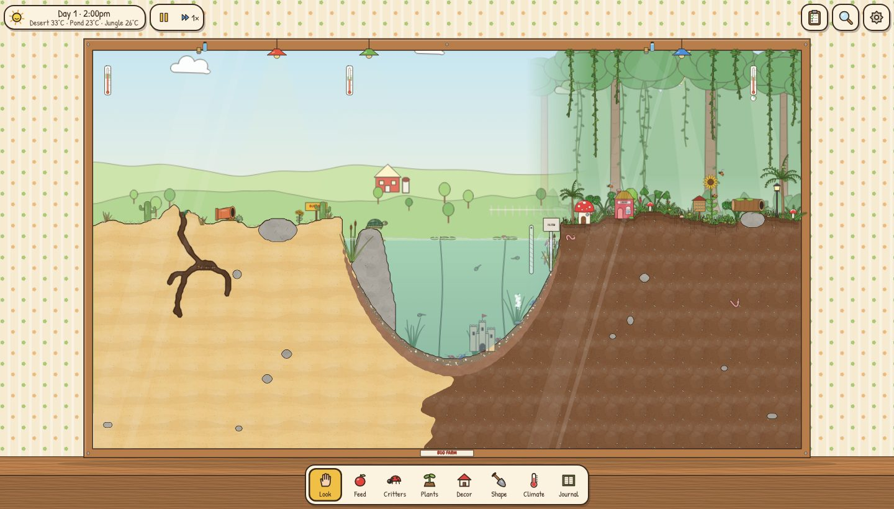
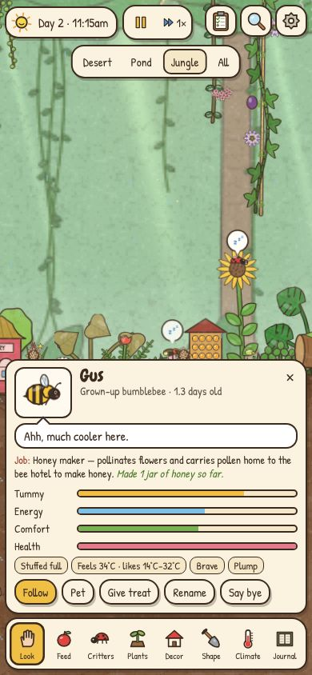

# Bug Farm

A cosy picture-book terrarium. One big glass tank with a sandy desert, a pond
and a grassy jungle, full of small critters going about their lives. Look after
them, feed them, rearrange their world, and run gentle experiments to see what
happens.





- **Runs in any modern browser** on phones, tablets and desktops. Nothing to
  install. It can also be added to the home screen and played offline.
- **Small and quick to load.** About 130 KB of gzipped JavaScript and two
  small fonts. All the art is drawn in code, so there are no image downloads.
- **Smooth on old hardware.** The static scenery is cached, critters are
  pre-rendered sprites, and the simulation runs at a fixed 30 steps a second.
  If a device struggles, the quality setting drops on its own.
- **Saves itself.** The tank is saved to the browser every 20 seconds and
  whenever you switch away. When you come back, it catches up on the time
  you were gone (up to about a day of tank time, and gently).

The art takes after Richard Scarry: ink outlines, washes of colour,
rosy cheeks, little hats, and houses made from teapots, boots and apples.
Nobody is scary, and nothing dies horribly. When a critter's time is up it
floats away under a little halo and a forget-me-not grows where it rested.

<br clear="right">

## The critters

Each species has its own needs, diet, comfort range and habits. They decide
what to do from moment to moment based on what they can see, smell, feel and
remember.

| Zone | Who lives there | What to watch for |
| --- | --- | --- |
| Desert | Ants, crickets, grasshoppers, a gecko, beetles, pill bugs | The ants run a real colony. The queen lays eggs, nurses raise the brood, and diggers carve tunnels and chambers and pile the sand into a mound. Foragers lay scent trails to food and recruit their nestmates. Crickets chirp faster when it is warm. The gecko basks under the lamp and stalks crickets. |
| Pond | Goldfish, frogs (from eggs to tadpoles to froglets), a turtle, pond snails, shrimp | The fish school together. The turtle climbs out to bask on the rocks. Warm water holds less oxygen, so overfeeding or a heat wave sends fish gasping at the surface. Tadpoles turn into frogs. |
| Jungle | Ladybugs, aphids, butterflies (from caterpillar to chrysalis), snails, bumblebees, earthworms, fireflies | A misty rainforest of palms, monsteras and bromeliads, with vines trailing from the lid. Ants farm aphids for honeydew and ladybugs hunt them. Bees pollinate flowers so they set seed. Worms surface when it rains. At night the fireflies' blinking slowly falls into sync. |

Fruit flies are uninvited guests who show up when fruit is left to rot.

## Growing your farm

A new farm starts small: each zone has just two kinds of critter (ants and
crickets in the desert, goldfish and pond snails in the pond, snails and
butterflies in the jungle). Each zone has a level and three keeper goals,
such as "keep the desert comfy for 6 hours", "a caterpillar wraps up in a
chrysalis" or "rinse out the pond filter". Finishing them levels the zone up
and unlocks new critters, snacks, plants and decorations: beetles and then a
gecko in the desert, shrimp, frogs and a turtle in the pond, and worms, pill
bugs, aphids, ladybugs, bees, fireflies and grasshoppers in the jungle. The
**Sandbox** choices on the welcome screen (or in Settings) unlock everything
at once.

The tank doesn't stay put, either. The weather outside changes every day or
so (warm and cool spells, heat waves, cold snaps, dry and muggy days), which
shifts the room temperature. Misters drink from a water bottle that runs dry,
the pond slowly evaporates below its fill line, the filter sponge clogs with
gunk, and leafy jungle plants make the air more humid as they grow.

None of that comes as a pop-up. Instead:

- **The keeper's clipboard** (top right) lists what needs doing, most urgent
  first, each with a one-tap fix: refill, rinse, top up, clean, or a jump to
  the right climate control or snack. Its badge shows how many things want
  attention. Each zone's tab shows its goals, progress and what's next.
- **Comfy ranges.** Every zone works out the temperature (and dampness) that
  suits whoever actually lives there, and says who's too hot or too dry.
  The clock colours each zone's temperature, the Climate panel shows the
  range on a gauge, and strip thermometers on the glass show it in the tank.
- **The forecast.** The clipboard and the Climate panel say what weather is
  coming, so a heat wave is never a surprise.

## How to play

| Tool | What it does |
| --- | --- |
| **Look** | Drag to pan, pinch or scroll to zoom. Tap a critter to see its needs, mood and what it is thinking, and to pet it or give it a treat. Tap the glass to startle everyone. |
| **Feed** | 38 foods, from apple slices and blueberries to fish flakes, sinking pellets and cookie crumbs. Each one shows which critters love it. Tap to drop it, or hold to sprinkle. Critters eat it bite by bite until it's gone. |
| **Critters** | Adopt new critters and choose where they live. |
| **Plants** | 20 plants, including daisies, sunflowers, ferns, monsteras, palms, bromeliads, cactus, aloe, cattails, water lilies and eelgrass. Each has its own temperature and moisture needs. |
| **Decor** | 26 decorations, including a library, a mushroom cottage, a teapot house, a boot, a banana car and a castle. Many of them do something useful: shelters give shade and warmth, bubblers add oxygen, lamp posts glow at night, the bee house lets bees breed, and feeders drop food every morning. The Styles tab changes the sand, soil and pond gravel, and the scenery painted behind the tank. |
| **Shape** | Paint sand, soil, rock or gravel, or dig tunnels yourself. You can also raise or lower the pond. |
| **Climate** | Set each zone's heat lamp and mister, the pond heater and filter, the room thermostat and the day/night cycle. Each zone shows its comfy range against the current reading. Refill the misters, clean the pond, rinse the filter, top up the water and tidy leftovers. Presets include *Just right*, *Heat wave*, *Cold snap*, *Rainy day* and *Dry spell*, and changing weather can be switched off. |
| **Journal** | The logbook of births, metamorphoses, meals and farewells, plus 39 discoveries to unlock. Discoveries unlock new decorations and styles. Sandbox mode unlocks everything. |
| **Clipboard** | The button at the top right. What needs doing now, how each zone is doing, and the goals for its next level. Tapping a thermometer on the glass opens it too. |

The lens button in the top right switches between overlays for temperature,
dampness, ant scent trails and what each critter is thinking. The speed control
offers pause, 1×, 3× and 8×. On a keyboard, `Space` pauses, `1` to `8` pick
the tools and `Esc` closes panels.

### Experiments to try

- **Overfeed the pond.** Leftovers spoil, the water clouds over, oxygen drops,
  and the fish come up to gulp air. Use *Clean pond* to recover.
- **Underfeed everyone.** Watch tummies rumble and critters search further
  afield. Hungry hunters start eyeing their neighbours.
- **Heat wave in the desert.** The ants retreat deep into their tunnels. Plants
  wilt and some critters seal up and wait for better days.
- **Cold snap.** Crickets chirp more slowly, the reptiles get sluggish, and the
  ladybugs huddle together.
- **Warm or chill the pond.** Fish are happiest in the middle of the range.
  Warm water holds less air.
- **Rainy day.** The earthworms come up to the surface.
- **Leave fruit to rot.** Fruit flies appear.
- **Add a predator.** The gecko eats crickets, frogs catch flies, and ladybugs
  eat aphids. The world stays mostly peaceful, but the food chain is real.

## Run it locally

You need Node 18 or newer.

```sh
npm install          # esbuild for the build, Playwright for the browser tests
npm run dev          # serve the source at http://localhost:8080
npm run build        # bundle into dist/ (one hashed JS file, offline service worker)
npm test             # headless browser smoke test of the source (npm test -- dist for the build)
```

To save bandwidth, `PLAYWRIGHT_SKIP_BROWSER_DOWNLOAD=1 npm install` skips the
browser download when you only want to build.

Other tools in `tools/`:

| Command | What it checks |
| --- | --- |
| `node tools/simtest.mjs [days] [seed]` | Runs the simulation headless and prints a population log and timing. |
| `node tools/fuzz.mjs [days] [seed]` | Has a random player feed, sculpt, adopt and change the climate, and reports any broken state. |
| `node tools/savetest.mjs` | Save and load round-trip, plus the "while you were away" catch-up. |
| `node tools/experiments.mjs` | Runs each experiment and checks that the expected outcome happens. |
| `node tools/progresstest.mjs [days] [seed]` | Plays a new farm with an attentive keeper and checks that every zone levels up. |
| `node tools/perf.mjs [dir] [cpuSlowdown]` | Frame times with the CPU throttled to imitate an old phone. |

`tools/dev.html` and `tools/gallery.html` show every critter, food, plant and
decoration on one page.

## Deploy

`.github/workflows/pages.yml` runs the tests and builds on every push and pull
request. Pushes to `main` are then published to GitHub Pages. In the
repository, go to **Settings → Pages → Source** once and choose
**GitHub Actions**.

`dist/` is a plain static folder, so any static host works.

## How it works

```
src/
  config.js            world size, grid, caps
  world/               terrain grid (sand/soil/rock/gravel/clay, water flood fill),
                       environment (zone climate, pond chemistry, day/night),
                       spatial hash, A* pathfinding, the World itself
  entities/            Creature (needs, life stages, movement), Plant, Food, Decor
  ai/                  utility brain, shared behaviours, food/prey/mate search,
                       ant colony (castes, brood, digging, scent trails, aphid herding)
  data/                species, foods, plants, decor, names, discoveries,
                       progression (what each zone level unlocks)
  art/                 procedural ink-and-watercolour drawing of everything
  render/              sprite cache, chunked terrain renderer, particles, frame
  ui/                  camera, touch input, toolbar, sheets, cards, journal
  sim/                 away catch-up, journal, care (comfy ranges and the
                       to-do list), progress (zone levels and goals)
  save/                localStorage save, backup, export/import
  audio/               tiny procedural sound effects (WebAudio, no files)
```

- **Brains.** Every critter senses its surroundings, scores the behaviours its
  species knows (forage, hunt, flee, bask, hide, court, chirp, pollinate,
  estivate and so on) against its current needs, and runs the best one.
  Ants have their own colony-level task allocation on top of that. Species and
  life stages are mostly data in `src/data/species.js`.
- **Simulation and rendering are separate.** `src/world` and `src/entities`
  never touch the DOM, so the whole tank runs headless in Node for the tests and
  for the catch-up after you've been away.
- **Rendering on a budget.** The terrain is drawn in 32-cell chunks with
  smoothed marching squares and redrawn only where it changes. The room,
  backdrop, terrain and frame are cached into a single background image.
  Critters are drawn once per pose and size bucket into a sprite cache.
- **Saving.** The save is compact JSON (about 36 KB, with run-length-encoded
  terrain) in `localStorage`, with a backup copy. Settings can export and
  import saves as files.

### Adding things

The catalogs are plain data, and most additions are a single line:

- **Food:** add an entry to `src/data/foods.js`. Pick an existing `shape` for
  its art, and give it `tags` (fruit, leaf, seed, protein, nectar…) so the
  critters know whether to eat it.
- **Plant:** add an entry to `src/data/plants.js` with a `kind`, colours and
  comfort ranges.
- **Decoration:** add an entry to `src/data/decor.js`, plus a draw function in
  `src/art/decor.js` if it needs new art.
- **Critter:** add a species to `src/data/species.js`, built from existing
  behaviours, and an entry in `CREATURE_ART` in `src/art/creatures.js`.
  Flyers also get a `WINGS` entry there (hinge point, length, beat rate).
- **Unlock:** list a critter, food, plant or decoration under a zone level in
  `src/data/progression.js`. Anything not listed is available from the start.

## Credits

- Fonts are self-hosted: [Patrick Hand](https://fonts.google.com/specimen/Patrick+Hand)
  (SIL Open Font License 1.1) and [Chewy](https://fonts.google.com/specimen/Chewy)
  (Apache 2.0). See `assets/fonts/README.md`.
- The look is inspired by Richard Scarry's Busytown books. All the art is
  original and drawn in code.
- The code is under the MIT License (see `LICENSE`).
